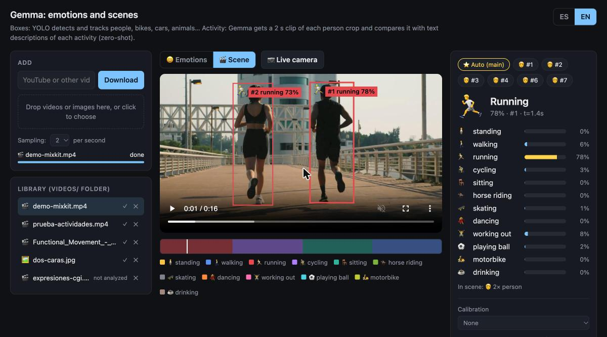

# Zero-shot emotions & activity recognition with EmbeddingGemma 2

**Can a 740M-parameter *embedding* model understand what people are doing in a video, with no training?**
This project tests [EmbeddingGemma 2](https://huggingface.co/google/embeddinggemma-2), Google DeepMind's multimodal (text · image · video · audio) embedding model, far outside its intended use case of semantic search. It runs fully locally as a small web app. The UI is in English and Spanish.


<sub>Scene mode on stock footage ([Mixkit](https://mixkit.co)). The timeline below the video shows the label at each moment: running → cycling → sitting → walking.</sub>

## Results

On a test reel of 11 three-second clips with no on-screen text, the model picked the right activity out of 12 candidates in **all 11 clips**:

| Clip | Ground truth | Prediction | Confidence |
|---|---|---|---|
| Two people jogging | running | 🏃 running ✅ | 76% |
| Woman drinking coffee | drinking | ☕ drinking ✅ | 81% |
| Small, distant cyclist in a park | cycling | 🚴 cycling ✅ | 85% |
| Woman dancing | dancing | 💃 dancing ✅ | 56% |
| Boy on a park bench | sitting | 🪑 sitting ✅ | 78% |
| Riders on a beach | horse riding | 🏇 horse riding ✅ | 82% |
| Woman walking in a park | walking | 🚶 walking ✅ | 60% |
| Cyclist filmed by a drone | cycling | 🚴 cycling ✅ | 93% |
| Kettlebell workout | working out | 🏋️ working out ✅ | 93% |
| Woman sitting on a sofa | sitting | 🪑 sitting ✅ | 64% |
| Olympic sprint | running | 🏃 running ✅ | 55% |

This is a small, hand-picked test set, so read it as a proof of concept rather than a benchmark. It can be reproduced with the scripts in `clips/`.

## How it works

An embedding model does not generate text or localize objects. It only maps an input to a 768-d vector. The pipeline therefore splits the work:

```
video frame ──► detector ──────────► boxes + track IDs (who / where)
                (OpenCV faces │ YOLOv8 people & objects)
                       │
                       ▼
            crop of each face, or 2 s clip (4 frames) of each person
                       │
                       ▼
            EmbeddingGemma 2 ──► image/video embedding
                                        │  cosine similarity
            "a person riding a bicycle" ─┤  vs. text embeddings of
            "a person sitting down"     ─┤  every candidate label
            ...                          ▼
                                 softmax ──► label + confidence
```

- **Zero-shot**: no fine-tuning. To add a label you write a sentence describing it (`EMOTIONS` / `ACTIVITIES` in `analyze.py`).
- **Temporal context**: each person is classified from a short clip using the model's native video input, not from a single frame.
- **Scene-cut detection**: the tracker is reset on hard cuts. Masked histogram and pixel-difference tests ignore letterbox bars.
- **Calibration** (optional): subtracting each label's mean similarity removes prompt bias. This matters a lot for emotions.

## Findings

1. **The model reads on-screen text, and that can look like understanding.** On a workout video with each exercise name captioned above the person, it scored **100%** using *only the caption strip* and dropped to **~30%** with the captions masked. Only cropped faces or persons are sent to the model for this reason, and any evaluation needs text-free footage.
2. **Coarse activities work; fine-grained ones don't.** It reliably tells running from cycling from sitting, but it can't tell a lateral lunge from a reverse lunge with press.
3. **Tracking across cuts matters.** Without cut detection, a track ID survived edits and the 2-second clip blended two scenes ("walking" was predicted as "horse riding"). Fixing this took accuracy from 9/11 to 11/11.
4. **70 vision tokens per frame is enough.** Halving the budget from 140 to 70 kept 11/11 at **2× the speed**.

## Performance (Mac mini, Apple Silicon, PyTorch MPS)

| Step | Time |
|---|---|
| YOLOv8m detection + tracking | ~36 ms / frame |
| EmbeddingGemma 2, 4-frame clip @ 70 tokens | ~0.5 s |
| EmbeddingGemma 2, face crop @ 70 tokens | ~0.13 s |
| Offline scene analysis | ~1.5× video duration |
| Live webcam | emotions ~12 fps · scene ~5–6 fps, labels refresh every ~0.7 s |

## Features

- 😄 **Emotion mode**: an emoji and label on every face, in videos and images, including images with several faces.
- 🎬 **Scene mode**: boxes on people, bikes, cars, horses, dogs… plus a per-person activity label and a clickable timeline.
- 📷 **Live camera**: both modes on a webcam stream over WebSocket.
- 📥 **Library**: paste a YouTube or other URL (downloaded with yt-dlp) or drag-and-drop videos and images. Analysis runs in a background queue.
- 🌍 **English / Spanish UI**, switchable with one click.

## Quick start

Requires Python 3.12, `ffmpeg` and [uv](https://docs.astral.sh/uv/).

```bash
uv venv -p 3.12 .venv
uv pip install -p .venv -r requirements.txt
.venv/bin/python server.py        # → http://127.0.0.1:8765
```

EmbeddingGemma 2 and the YOLOv8 weights are downloaded on first run. To use weights you already have, put them in `models/`.

CLI:

```bash
.venv/bin/python analyze.py videos/clip.mp4 --mode scene --fps 2   # or --mode emotion
```

Reproduce the activity benchmark:

```bash
clips/download_raw.sh                  # fetches the source clips (not redistributed here)
.venv/bin/python clips/make_test.py    # builds the 11 × 3 s test reel
.venv/bin/python analyze.py videos/prueba-actividades.mp4 --mode scene --fps 2
.venv/bin/python clips/evaluate.py     # compares against clips/prueba-actividades.json
```

## Project structure

| File | Purpose |
|---|---|
| `analyze.py` | Detection, tracking, cut detection and EmbeddingGemma 2 zero-shot classification |
| `server.py` | FastAPI server: media library, yt-dlp downloads, background analysis queue |
| `live.py` | Live webcam mode (WebSocket; per-frame detection, asynchronous Gemma updates) |
| `index.html` | Single-file front end (canvas overlays, timeline, i18n) |
| `clips/` | Test reel builder, ground truth and evaluation script |

## Stack

[EmbeddingGemma 2](https://huggingface.co/google/embeddinggemma-2) · [sentence-transformers](https://www.sbert.net/) · PyTorch (MPS) · [Ultralytics YOLOv8](https://github.com/ultralytics/ultralytics) + ByteTrack · OpenCV · FastAPI · yt-dlp

---

<sub>🇪🇸 Experimento con EmbeddingGemma 2: reconocimiento *zero-shot* de emociones y actividades en video, imagen y cámara en directo, todo en local. Interfaz en español e inglés.</sub>
